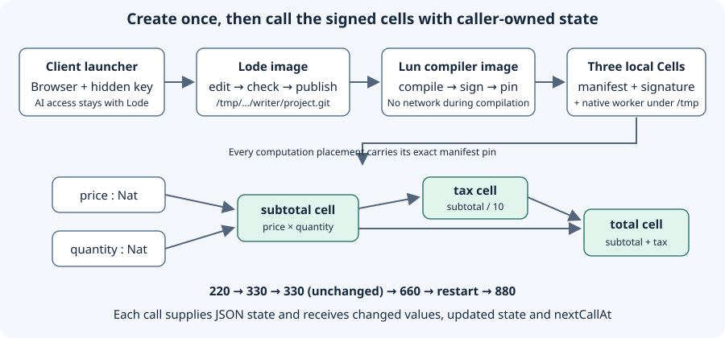

# Create local cells with Lode and run their DAG

The [demo launcher](../Examples/lode-dag/launch.command) runs Lode in an image
with a Git repository under `/tmp`. Lode uses an AI to implement and prove three
Lean functions. It checks and publishes a local source commit. Lun compiles that
commit into signed Linen 4.1 native cells and executes their invoice DAG through
local cell workers, one caller request at a time.



Lode is the author; Lun is the compiler and executor. In this example Lode
produces source, and Lun's compiler produces the signed cell packages. The demo
does not import independently exported Lode packages into a Lun graph. See
[native cells](native-cells.md) for the manifest, admission and trust contracts.

## Prepare the images

Use this Lun checkout and a sibling `../lode` checkout supporting Linen 4.1,
with a running Podman engine. The host needs Bash, Git and Python 3.12+; the
images carry Lean 4.36, native build dependencies and GnuPG. Docker is also
supported with `--engine docker`. No host repository or credential directory is
mounted into the containers; tar streams transfer the scratch source and results,
including when Podman runs in a VM.

First build the images and rehearse without inference:

```sh
Examples/lode-dag/run.sh --engine podman --mode scripted --build --yes
```

This may take more than ten minutes on the first build and needs network access
to fetch compiler dependencies. `--build` uses the current source trees and
creates local `localhost/lode:cells-demo` and `localhost/lun:cells-demo` images.
The Lun image uses the opt-in Dockerfile target `cell-demo`, which includes the
pure Liaison SDK for offline driver builds. The default production target stays
`runtime`. Subsequent runs reuse these images; no image is pulled implicitly.

Scripted mode replaces only model responses. It still uses the real Lode tools,
Lean checker, local Git publication, Lun compiler, signatures and cell workers.
Its output says **SCRIPTED REHEARSAL**. It establishes no live AI conformance.

## Launch with AI access

Run this in your terminal, or double-click `launch.command` on macOS:

```sh
Examples/lode-dag/launch.command
```

The launcher prompts for the provider, model and optional API protocol. It can
open the HTTPS credential page you supply in your client browser, then reads the
API key with hidden terminal input. Use a model name available in your account;
for a Responses endpoint, enter `responses` as the protocol. The key is passed
through the child environment, never as a command argument or configuration file.
The known key is redacted from saved Lode stdout/stderr. Do not put secrets in the
browser URL or other arguments. The browser page supplies a credential; this
launcher does not turn a website login into API authorization.

Lode also supports issuer-configured browser OAuth through its HTTP server.
That requires a registered client, issuer, redirect URI and bearer-compatible
model endpoint; see Lode's `docs/architecture/lode.md`, “Browser OAuth”. The CLI
run used here uses a direct key. An OAuth grant on an existing HTTP session is
not inherited by a new CLI session.

For an automated run, configure the key in your shell through your usual secret
manager, and supply non-secret configuration:

```sh
# LODE_MODEL_API_KEY is already set in this shell.
Examples/lode-dag/run.sh --provider YOUR_PROVIDER --model YOUR_MODEL --yes
# Optional protocol and endpoint:
#   --api responses --base-url https://YOUR_ENDPOINT/v1
```

You can reuse an existing image container with startup model configuration:

```sh
Examples/lode-dag/run.sh --lode-container YOUR_CONTAINER --yes
```

That container needs the current `lode` CLI, toolchain and `/opt/lode/cache`.
The demo creates a separate `/tmp` workspace and leaves the supplied container
running. It does not attach to an existing Lode HTTP session. The compiler always
runs in a separate container with networking disabled.

`run.sh --help` lists effective defaults and their sources. Resolution is flags >
environment > selected TOML `[demo]` table > shipped defaults. Use
`--defaults FILE` to select a partial table. Most environment variables are
`LODE_DAG_<OPTION>`; provider/API/base URL/model use `LODE_MODEL_PROVIDER`,
`LODE_MODEL_API`, `LODE_MODEL_BASE_URL`, `LODE_MODEL_NAME`. Set
`LODE_DAG_PYTHON` to select Python. Preview without files, AI or engine access:

```sh
Examples/lode-dag/run.sh --dry-run
```

The helper displays its plan and asks before running; non-interactive use needs
`--yes`. `--interactive` pauses between stages. Output is colored on a terminal,
plain when piped or with `NO_COLOR`/`TERM=dumb`. The final artifact path goes to
stdout; progress goes to stderr.

## What each stage does

1. **Prepare.** Start owned writer/compiler containers and create distinct
   `/tmp/lode-dag.<run>/writer` and `/tmp/lode-dag.<run>/compiler` trees inside
   them. No writes are made to your project source.
2. **Seed.** Create a bare `writer/project.git` with a committed Lean project,
   exact Linen revision, three stubs and caller-owned `lun.json` graph contracts.
3. **Author.** Invoke `lode run --config .../session.json` with the task on stdin.
   Lode may read/edit/check/publish. Its task implements `subtotal`, `tax` and
   `total`, with proofs of their arithmetic behavior. All effects are `Eff []`.
4. **Pin.** Read `lode output SESSION --format git`, verify the published commit,
   and refuse edits to anything except `Demo/Cells.lean`. Transfer the local bare
   repository to the compiler. “Publish” here means committing/pushing to this
   scratch bare repository, without a remote hosting service.
5. **Compile.** Generate a disposable compiler signing key, build the exact
   source commit through `lun cli`, and require `stateless-cells-v5`, three cell
   manifests and exact pins on every computation node.
6. **Step.** Invoke the graph repeatedly. Save each returned JSON state before
   supplying it to the next call; verify arithmetic, unchanged input and rejection.
7. **Restart.** Stop/restart the Lun CLI and resume from the saved caller state.
8. **Export.** Copy out source, signed packages, public keyring and JSON results.
   Verify exported manifest pins and payload hashes/lengths. Stop owned containers
   and their workers. Private signing material is not exported.

The implementation Lode is asked to produce is:

```lean
import Linen.Control.Monad.Effect
open Control.Monad.Effect
namespace Demo

def subtotal (price quantity : Nat) : Eff [] Nat := pure (price * quantity)
def tax (amount : Nat) : Eff [] Nat := pure (amount / 10)
def total (amount levy : Nat) : Eff [] Nat := pure (amount + levy)

-- Each is quantified over all inputs; Lean checks it, without `sorry`.
theorem subtotal_correct (price quantity : Nat) :
    (subtotal price quantity).run = price * quantity := rfl
end Demo
```

The task also requires equivalent theorems for `tax` and `total`, and docstrings.
The protected `Demo.lean` root applies all three theorems at their exact universal
types, so Lode's project check also checks these proofs against the fixed contract.
Values are integer cents and tax is ten percent rounded down. The graph is:

```lean
do
  let p ← input "price" Nat
  let q ← input "quantity" Nat
  let s ← subtotal p q
  let t ← tax s
  total s t
```

Each application runs its pinned local cell. `price` and `quantity` are typed
source data. The request additionally fixes each function signature, `Nat`
output type, input layout, and ordered named direct dependencies.

## Follow the state changes

| Request | Input update | Subtotal | Tax | Total |
| --- | --- | ---: | ---: | ---: |
| 1, initial state | price = 100, quantity = 2 | 200 | 20 | 220 |
| 2, previous state | quantity = 3 | 300 | 30 | 330 |
| 3, previous state | quantity = 3 again | 300 | 30 | 330 |
| 4, previous state | price = 200 | 600 | 60 | 660 |
| refused | quantity = `"wrong"` | — | — | — |
| 5, after restart | quantity = 4 | 800 | 80 | 880 |

Request 3 must return an empty `changed` list. The wrong-type request must return
400; the caller retains its last valid state. Every successful response has
`nextCallAt: null`, because these cells have no timers or producers. The restart
reuses compiled code and the caller's saved JSON. No recompilation occurs between
these graph calls.

The helper sends JSON lines to one persistent `lun cli` process. For example,
the first graph call has this shape (replace `BUILD_ID`):

```json
{"method":"POST","path":"/v0/builds/BUILD_ID/graphs/invoice","body":{"now":1000,"inputs":{"price":100,"quantity":2},"state":null,"policy":{"effects":[],"domains":[]},"binding":{"org_id":"demo","user_id":"local","graph_id":"invoice"}}}
```

Later requests replace `state` with the previous response's `body.state`. An
HTTP client uses the same path/body. Lun retains code; the caller retains state.

## Inspect the local cells

The launcher prints a new host directory under `/tmp`. Copy that path here:

```sh
work=/tmp/lode-dag.REPLACE_ME
cat "$work/result.json"
git --git-dir="$work/project.git" show main:Demo/Cells.lean
cat "$work/build.json"
cat "$work/step-1.json"
cat "$work/step-5.json"
cat "$work/cells/subtotal/manifest.json"
gpgv --keyring "$work/compiler.gpg" \
  "$work/cells/subtotal/manifest.asc" "$work/cells/subtotal/manifest.json"
```

`cells/{subtotal,tax,total}/` each contains `manifest.json`, `manifest.asc` and
`worker`. These are Linen v2 native cell packages; their target is the image's
Linux architecture. Use Lun's verified invocation path to supply the protocol
and authority, rather than treating the worker as an unframed arithmetic CLI.
The build's private worker backing file may be shared by hardlinks within the
export, while every signed manifest fixes its own callable contract.

Other files include `build-request.json`, `lode-receipt.json`, `state.json`,
`refused-input.json` and compiler/agent logs. `result.json` records the mode,
commit, cell pins, totals and container IDs. `--output NEW_DIR` selects another
new directory; an existing directory is refused. `--keep-containers` retains
owned containers for inspection, including their disposable signing material;
otherwise they are stopped automatically. A supplied `--lode-container` is
always left running. Retain or remove the scratch results deliberately.

The demo key expires after one day and proves only this local rehearsal's
compiler origin. Production signing needs an operator-owned trust profile and
build/key isolation. Lean proofs do not sandbox build scripts; see
[runtime boundaries](runtime-guarantees.md).

For a host-only diagnostic rehearsal with already-built sibling binaries:

```sh
Examples/lode-dag/run.sh --engine native --mode scripted --yes
```

This copies the existing Linen build to a private `/tmp` cache and emits host
executables. Live authoring requires a container. On macOS installations where
the bundled linker cannot read the SDK's TAPI format, use
`LEAN_CC=/usr/bin/clang LIBRARY_PATH=/opt/homebrew/lib` for this diagnostic path.
