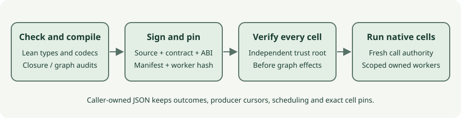

# Native cells in executed DAGs

Every executable DAG node is a compiler-attested native cell. Named inputs
remain caller-owned source values. Lun uses Linen 4.1's `System.Cell` manifests,
verification handles and owned local workers.

For a runnable authoring-to-execution example, follow
[Lode → local cells → DAG](lode-local-dag.md).



## Compilation and pinning

The build request still declares `functions` and `graphs`. After checking the
project uses the compiler's exact Lean toolchain (currently 4.36.0), the
Lean signatures, graph layout and executable closure, Lun builds the driver
with warnings treated as errors and emits a manifest for each declared function
or producer under `builds/{id}/cells/{name}/`. Each directory has `manifest.json`,
its detached `manifest.asc`, and `worker`. Variants hard-link the build's native
payload copy to avoid copying it for every cell. That copy has a separate inode
from the graph driver, so damaged packages cannot modify the executor. It multiplexes only
the exact checked contracts; the private call also names the cell placement.
Linux drivers are linked with non-runtime ELF symbols stripped to fit Linen's
128 MiB artifact bound; the dynamic symbol table and loader metadata are retained.
The linker option is included in the compiler's build fingerprint.

A manifest fixes the resolved declaration, source commit, ordered signature,
producer shape, target/toolchain, runtime ABI, audit version, codec identity and
payload hash/length. Its build key fingerprints the actual project sources,
generated wrapper, transitive dependency sources/locks, explicit object/library
inputs and linker response/options. The toolchain identity and provisioned host
libraries remain part of the trusted runtime profile.

The canonical build request is the intent record. Its admitted function
signatures, output constraints and Lun audit version form the static policy
record. Runtime permission ceilings are supplied independently on every call.
Ready status includes `cells`; computation nodes in the graph description and
graph responses carry their exact `cell` manifest hash. These are local build
artifacts. No remote registry publication is performed.

## Execution and state

Before any graph effects, Lun verifies **all** used manifests and payloads
against the compiler-owned pins, configured public keyring and independently
derived host contract/runtime requirements. A request cannot replace `_cells`
or `_runtime`. The worker retains verified bytes, so later file changes cannot
change that step's executable. A later graph call verifies the files again.

Each used cell owns one native worker for the graph step; repeated occurrences
reuse that worker. A readiness handshake starts parent supervision without
executing user code. At most 16 distinct cells are permitted per graph. Workers
run with an empty environment, decode each invocation before effects, and receive
fresh policy, bindings and grants through private stdin. Parent-side dictionaries
check every result and producer continuation/emission before it enters state.
The graph-wide Trace limit remains 1 MiB. Native workers stop on scope exit; a
private heartbeat uses atomic timestamp replacement and bounds their lifetime
after abrupt parent failure.

The incremental algorithm, input ordering, burst budget and `nextCallAt` contract
are unchanged. Caller-owned state additionally binds exact manifest pins. Rebuild
legacy artifacts and begin with fresh state when adopting the
`stateless-cells-v5` runtime. Standalone function endpoints continue to use their
audited, canonical in-process interpreter; the native-cell requirement applies
to DAG execution.

Result types now need both `Lean.ToJson` and `Lean.FromJson`: the consumer checks
the native reply with its own decoder. Producer arguments, cursors and individual
outputs retain their existing type checks. Lun still rejects dependent function
signatures; Linen's general input-indexed cell results need a separate adapter.

## Operator configuration

Set these three variables together before starting Lun:

| Variable | Meaning |
| --- | --- |
| `LUN_CELL_SIGNING_KEY` | Complete OpenPGP fingerprint of the compiler signing key |
| `LUN_CELL_SIGNING_HOME` | Existing private compiler GnuPG directory |
| `LUN_CELL_KEYRING` | Public keyring of trusted compiler signers |

Lun creates no production keys. A build containing graphs fails with an
actionable error if signing is unconfigured. GnuPG and `gpgv` must be installed.
The Docker image includes them; operators mount/provision their keys separately.
Only the public keyring is passed to the execution side. Signing-home variables
and agent configuration are removed from project build/worker environments.

**Keep the signing key and trusted compiler outputs inaccessible to untrusted
build code.** Lakefiles and metaprograms execute during compilation. Environment
filtering alone is insufficient filesystem isolation. The build/container,
compiler, native FFI and host library boundaries described in
[runtime guarantees](runtime-guarantees.md) remain trusted; signatures do not
prove arbitrary code safe.

For disposable local examples and regression suites only:

```sh
python3 test/cell_compiler.py -- uv run Examples/interactive/run.py --linen ../linen --demo
test/e2e.sh ../linen
```

The test helper creates keys in a private temporary directory and removes them
and their agent afterward. `test/e2e.sh` and `test/local.py` use disposable keys
automatically when no compiler is configured. CI wraps each example suite with
the helper. For persistent ready builds, provision a persistent compiler key
and public keyring instead.

See the numbered [cell contract](../Lun/Cell/SPEC.md) and
[runtime authority](runtime-guarantees.md) for the guarantees and boundaries.
